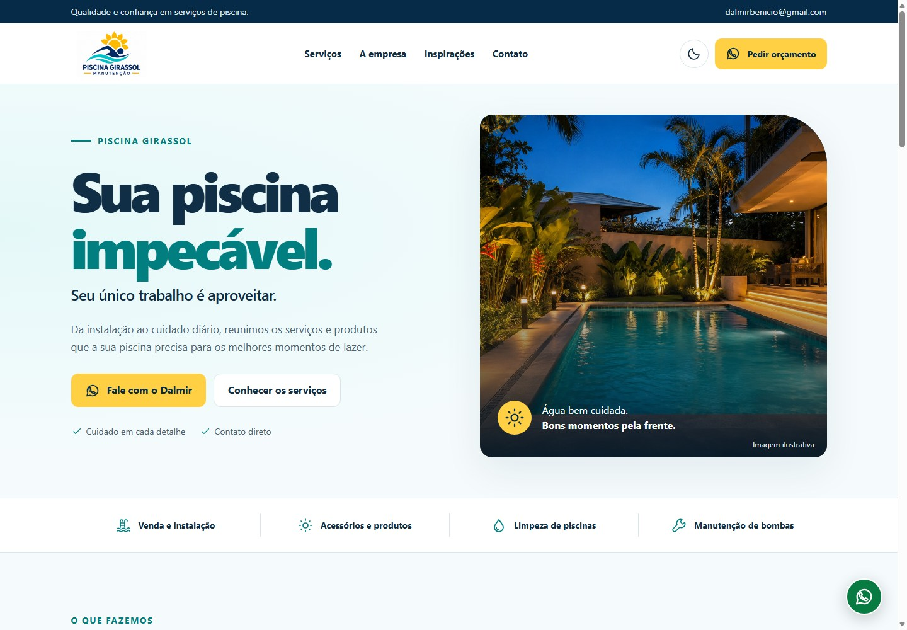

# ☀️ Piscina Girassol

**Sua piscina impecável. Seu único trabalho é aproveitar.**

Site institucional da Piscina Girassol, com apresentação da empresa, categorias de serviços e contato direto com o Dalmir. Desenvolvido em **HTML, CSS e JavaScript**, sem frameworks, dependências externas ou etapa de compilação.



## 🏊 Serviços apresentados

- **Venda, instalação e manutenção de piscinas** — soluções para a estrutura e o cuidado da piscina.
- **Acessórios e produtos químicos** — complementos e produtos para a rotina de cuidados.
- **Limpeza de piscinas** — atenção à água e aos momentos de lazer.
- **Manutenção e restauração de bombas** — cuidado com os equipamentos de circulação.

## ✨ Recursos

- 📱 Layout responsivo para computador, tablet e celular, incluindo telas de 320 pixels.
- 🌓 Temas claro e escuro: preferência do sistema na primeira visita e escolha salva no navegador.
- 🖼️ Carrossel manual com botões, indicadores, teclado e gesto horizontal no celular.
- 💬 WhatsApp com mensagem relacionada ao serviço escolhido e botão flutuante.
- ✉️ E-mail clicável, usando o aplicativo de e-mail configurado pelo visitante.
- ♿ Menu acessível, foco visível, atalho para o conteúdo e respeito à redução de movimento.
- ⚡ Imagens otimizadas, carregamento adiado e fontes disponíveis no próprio dispositivo.

## 🚀 Executar localmente

É necessário ter **Node.js 20 ou superior** para usar o servidor incluído. Não é necessário executar `npm install`.

```bash
git clone https://github.com/Lcsf-dev/piscina-girassol.git
cd piscina-girassol
npm run dev
```

Abra **http://127.0.0.1:5500**. Para encerrar, use `Ctrl + C` no terminal.

O comando `npm start` também inicia o servidor. A página pode ser aberta diretamente pelo `index.html`, mas o servidor local oferece melhor compatibilidade com o manifesto e os ícones.

## 📁 Organização

```text
piscina-girassol/
├── assets/
│   ├── icons/                 # Favicons e ícones por plataforma
│   └── images/
│       └── originals/         # Imagens originais preservadas
├── docs/
│   └── preview.jpg           # Prévia real da página inicial
├── scripts/
│   ├── main.js               # Menu, carrossel, tema e contatos
│   ├── server.js             # Servidor local sem dependências
│   └── theme.js              # Define o tema antes de desenhar a página
├── styles/
│   └── main.css              # Identidade visual e responsividade
├── browserconfig.xml         # Atalhos compatíveis com Windows
├── favicon.ico               # Ícone com resoluções 16, 32 e 48
├── index.html                # Conteúdo institucional
├── package.json              # Comandos do projeto
├── site.webmanifest          # Nome, cores e ícones para atalhos
└── README.md
```

Os nomes de arquivos e pastas seguem o padrão em inglês. Classes, variáveis, funções, textos e comentários estão em português sempre que aplicável. A indentação usa quatro espaços, definida também no `.editorconfig`.

## 🎨 Personalizar

| Alteração | Onde editar |
| --- | --- |
| Textos, categorias e informações da empresa | `index.html` |
| Número do WhatsApp e endereço de e-mail | Links `wa.me` e `mailto:` no `index.html` |
| Mensagem específica de cada serviço | Atributos `data-servico` e tratamento em `scripts/main.js` |
| Fotos e legendas do carrossel | Lista `imagens` em `scripts/main.js` |
| Cores, espaçamentos e pontos de adaptação | `styles/main.css` |
| Nome e cores dos atalhos | `site.webmanifest` |

As fotografias são **ilustrativas**. Os arquivos originais e a referência de contato foram preservados em `assets/images/originals/`.

## 📲 Favicons e atalhos

O projeto inclui **SVG**, **ICO com múltiplas resoluções**, PNGs de **16, 32, 48 e 96 pixels**, ícone **Apple Touch de 180 pixels**, ícones **Android de 192 e 512 pixels**, versão **maskable**, máscara monocromática para abas fixadas do Safari e ícone de **150 pixels para Windows**.

O manifesto prepara a identidade dos atalhos. O site não implementa funcionamento offline nem um service worker.

## ✅ Validação

```bash
npm run check
```

Esse comando verifica a sintaxe dos três arquivos JavaScript. Na conferência em navegador também foram verificados:

- Layout nas larguras **320, 390, 768, 1024 e 1440 pixels**, sem rolagem horizontal.
- Menu móvel, fechamento por `Esc`, navegação do carrossel e seleção por indicadores.
- Alternância de tema e persistência depois de recarregar a página.
- Carregamento das imagens, recursos locais e endereços de WhatsApp e e-mail.

## 🌐 Publicação

O site é estático: a hospedagem deve servir o `index.html` na raiz, junto dos arquivos CSS, JavaScript, imagens, ícones e manifesto. **Não há build, banco de dados ou backend obrigatório.** O `scripts/server.js` é apenas uma conveniência para desenvolvimento local.

Publicar o código no GitHub e colocar o site no ar são etapas diferentes. O repositório armazena o projeto; o endereço público do site depende da hospedagem escolhida.

## 📞 Contato da empresa

- **Responsável:** Dalmir
- **WhatsApp:** [(21) 98832-8878](https://wa.me/5521988328878)
- **E-mail:** [dalmirbenicio@gmail.com](mailto:dalmirbenicio@gmail.com)
